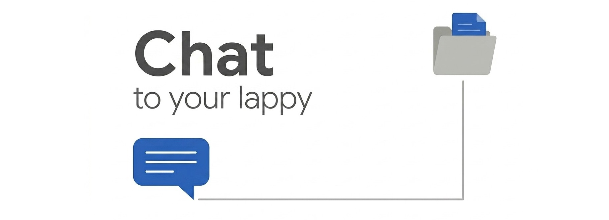

# Lappy RAG



## *Chat with your local Markdown empire. Locally.*

Your runbooks, ADRs, SOPs, and wikis live in Markdown files. No AI assistant can see them. This project indexes those files locally and runs a local LLM to answer questions about them, with no cloud dependency and no data leaving your network.

Everything runs in Docker. Bring your own docs.

---

[Why This Exists](#-why-this-exists) · [Quick Start](#-quick-start) · [Docs](docs/)

---

## What You'll Learn

**Getting Started:**
- [Why This Exists](#-why-this-exists): the problem it solves
- [What You Get](#-what-you-get): system components at a glance

**Implementation:**
- [How It Works](#-how-it-works): architecture in plain language
- [Quick Start](#-quick-start): get running in minutes

**Going Further:**
- [Docs](docs/): detailed guides

---

## 💡 Why This Exists

Your team's runbooks, onboarding guides, architecture decisions, and SOPs live in Markdown files. No AI assistant can answer questions about them without ingesting those files, and sending them to a cloud model is often not an option.

This project runs the full RAG pipeline locally. You ask a question; a local LLM searches your indexed docs and answers with context from your actual documentation. Nothing is sent anywhere.

---

## ⚙️ What You Get

| Component | Role |
| --- | --- |
| **Meilisearch** | Hybrid vector + keyword search index for your documents |
| **Embed server** | Local `bge-base-en-v1.5` model, computes document vectors |
| **LocalAI** | Local `gemma-4-12b`, serves chat completions |
| **MCP server** | Exposes `search_docs` and `hybrid_search_docs` tools to any MCP-compatible client |
| **Ingest pipeline** | Crawls your Markdown folders and populates the index |

---

## 🔍 How It Works

You define **project bundles**: YAML files that map a local folder to chunking rules. The ingest job reads those files, chunks each document, embeds the chunks, and stores them in Meilisearch.

The **MCP server** runs alongside Meilisearch and exposes two search tools over HTTP (SSE transport). Any MCP-compatible AI client (such as VS Code with an MCP extension) can call those tools and use the returned chunks as context for a locally-run answer.

All models run locally. Your documents stay on your machine.

---

## 📦 Quick Start

1. Copy the env template and set a master key:

   ```
   cp docker/env/.env.example docker/env/.env
   ```
   Edit `MEILI_MASTER_KEY` in `docker/env/.env`.

2. Copy the example bundle and configure your doc paths:

   ```
   cp -r configs/bundles/shared.example configs/bundles/personal
   ```
   Edit the YAML files in `configs/bundles/personal/` and set `host_path` to your local folder.

3. Start the stack:

   ```
   docker compose -f docker/compose.yml up --build
   ```

4. Run an ingest job:

   ```
   docker compose -f docker/compose.yml run --rm ingest-job --project=<your-project-id>
   ```

5. Connect an MCP client. For VS Code, add to `settings.json`:

   ```json
   {
     "mcp": {
       "servers": {
         "local-docs": { "type": "sse", "url": "http://localhost:3000/sse" }
       }
     }
   }
   ```

See [docs/](docs/) for bundle configuration, environment variables, and deployment guides.

---

## 📚 Docs

1. [Architecture](docs/01-architecture.md): components, data flow, and ports
2. [Setup](docs/02-setup.md): prerequisites, environment variables, first run
3. [Bundles](docs/03-bundles.md): project file format, chunking strategies, team sharing
4. [Ingest](docs/04-ingest.md): full vs incremental runs, one-shot job vs API
5. [MCP Client](docs/05-mcp-client.md): available tools, VS Code config, SSE endpoint
